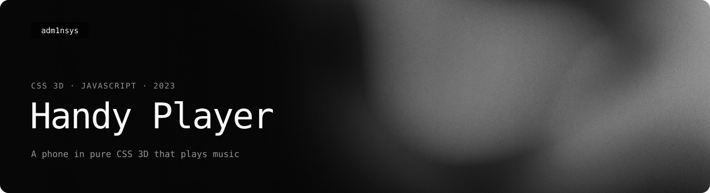
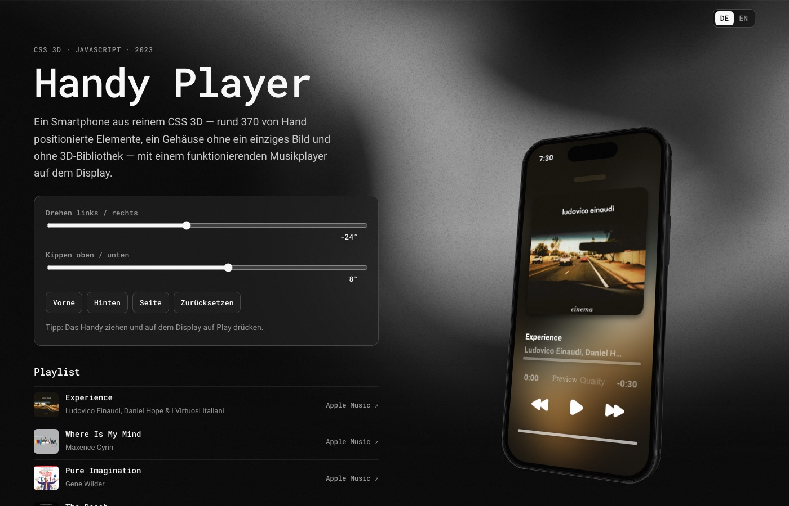

<picture>
  <source media="(prefers-color-scheme: light)" srcset=".github/readme/banner-light.svg">
  
</picture>

  
  
  
  

A smartphone built from pure CSS 3D — about 370 hand-positioned elements and no 3D library — with a working music player on its screen. Made in July 2023.

## What's inside

- **The phone** — body, frame, buttons, triple camera, front camera cutout and a second screen on the back, every part a `div` placed with `preserve-3d` transforms ([`src/phone.js`](src/phone.js)).
- **The player** — artwork, title and artist, progress and volume, play / previous / next, a lock-screen clock; the power and volume buttons on the side work too.
- **Rotation** — sliders for both axes, quick views (front, back, side) and drag with mouse or finger.
- **Music** — 30-second previews from Apple Music; each track links back to Apple Music.

## History

The phone was part of my former Admin Store website (2023). This repository moves it out of that site's old asset repository into a project of its own. [`src/phone.js`](src/phone.js) is kept as written — the first commit is the untouched 2023 version — and the 2026 changes are marked in the code:

- new branding: the HR monogram and “Designed by Heorhii Romanenko” on the back;
- the page around it: rotation controls, playlist, German / English switch; since November 2026 with the header and footer of my other project sites.

Run locally with any static server, for example `python3 -m http.server`.

## License

Code under [MIT](LICENSE) © Heorhii Romanenko. The song previews and artwork are streamed from Apple Music and remain the property of their rights holders.
